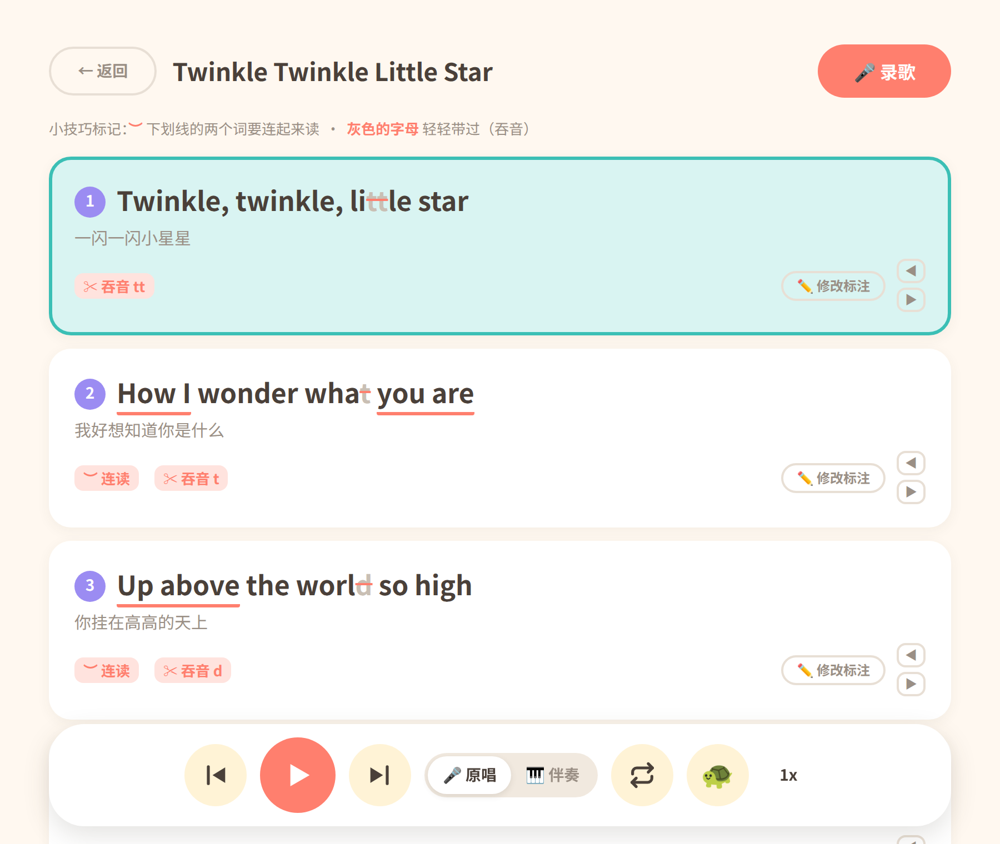

<div align="center">
  
  <h1>tinker</h1>
  <p><strong>把电脑里正在播放的英文歌，变成能一句一句跟唱的教材</strong></p>
  <p>内录 · 逐句对齐 · 连读吞音标注 · 伴奏分离 · 跟唱回放，全部在本机完成</p>
  <p>
    
    
    
    
    
    
  </p>
</div>



tinker 是一个跑在 Arch Linux 单机上的英文歌学唱应用。它把浏览器里正在播放的英文歌录成音频，按歌词切成一句一句，逐句显示翻译、连读和吞音提示，再让孩子跟着去掉人声的伴奏唱、录下来回放。

主要用户是小学生（以及想一起唱的家长）。界面刻意做得大而简单；所有音频、模型和学唱记录都留在本机，运行时**不调用任何外部 API**，也不需要账号。

## 功能

**🎙️ 录制与歌单**

- 一键内录系统输出（PipeWire / PulseAudio monitor source），不用下载歌曲文件
- 保存新录音时自动裁掉首尾静音，开头留 0.2s、结尾留 0.5s，时长按成品实际音频计算
- 歌单拖动排序、删除二次确认；删歌会连伴奏和跟唱录音一起清理，不留孤儿文件

**📖 逐句学唱**

- 中英歌词混贴导入：含中文的行自动作为上一英文句的翻译，不用逐行配对
- faster-whisper 词级时间戳 + 歌词文本匹配自动分句，再按换气能量低谷细化句界
- 整首连播、当前句高亮；点句跳转、单句循环、上一句 / 下一句、0.5x / 0.75x / 1x
- 本地规则引擎标注连读（`-`）和吞音（`^`）；每句都能手动修改标注，或一键恢复自动结果
- 句界不准时，句卡右侧 ◀ / ▶ 把边界吸附到最近的换气低谷，邻句自动同步

**🎹 伴奏与跟唱**

- Demucs `htdemucs_ft` 在本地分离人声；伴奏做响度对齐原曲 + 3k/10k 临场感 EQ，输出 320k mp3
- 学习页原唱 / 伴奏随时切换，保留播放位置、暂停状态和变速
- 跟着伴奏录下自己的声音：按首帧采集时刻与起播墙钟对齐，再和伴奏混成 mp3
- 「我的唱录」跨歌陈列所有成品，可改名、拖动排序、回放、删除

**🧒 为孩子设计**

- 大字号、表情封面、录音波纹动画、跟唱戴耳机提示
- 分句和伴奏都在后台跑，界面不阻塞；失败给出中文提示，可重试
- 单机单用户，数据全在 `data/`；删除是彻底删除

## 工作原理

```text
浏览器（原生 HTML/JS/CSS，零构建）
   │ HTTP
FastAPI
   ├─ 录音   parec @DEFAULT_MONITOR@ | ffmpeg  → data/recordings/*.wav
   ├─ 分句   faster-whisper medium.en 词级时间戳 + 歌词匹配 + RMS 换气口切边
   ├─ 标注   cmudict 音素 + 英语连读/吞音规则
   ├─ 伴奏   Demucs htdemucs_ft（torch CPU，子进程）→ LUFS/EQ → 320k mp3
   └─ 唱录   默认麦克风 parec + 起播偏移 → ffmpeg 与伴奏混音
数据：data/songs.json（元数据）+ recordings / stems / takes（音频）
```

## 环境要求

- Linux，PipeWire 或 PulseAudio；需要 `parec`（Arch 上由 `libpulse` 提供）和 `ffmpeg`
- Python 3.11+ 和 [uv](https://docs.astral.sh/uv/)
- 只跑 CPU，不需要显卡；首次分句 / 做伴奏会下载模型，连同 torch CPU 环境大约占用 3–4GB 磁盘，之后可离线使用

Arch 上补齐系统依赖：

```bash
sudo pacman -S ffmpeg libpulse
```

## 安装与启动

```bash
git clone https://github.com/kimiellen/tinker.git
cd tinker/backend
uv sync
uv run uvicorn tinker.main:app --host 127.0.0.1 --port 8000
```

浏览器打开 <http://127.0.0.1:8000>。

`uv sync` 只解析 Linux 环境；首次运行会自动创建 `data/`。

## 使用流程

1. **录一首歌**：先在浏览器里打开网易云音乐并暂停。回到 tinker 点「添加新歌」，看到波纹动画后马上播放歌曲；歌放完再点停止、给歌起名。保存时会自动裁掉首尾静音。
2. **贴歌词**：点歌曲卡片，把英文歌词一行一句贴进去；中文翻译紧跟在英文句下一行，自动配对。点「✨ 保存并开始分句」。
3. **逐句学**：分句完成后进入学习页。点任意一句跳过去播放，可以开单句循环、切换上一句 / 下一句、选 0.5x / 0.75x / 1x；红色下划线是两个词要连读，灰色字母轻轻带过（吞音）。
4. **修标注和句界**：点「✏️ 修改标注」改当前句；句卡右侧 ◀ / ▶ 把句界吸附到换气口。
5. **切伴奏、录跟唱**：伴奏保存后会在后台自动生成，学习页可随时切「原唱 / 伴奏」。点「🎤 录歌」戴上耳机跟着伴奏唱，结束后可回放、收下或丢弃。
6. **我的唱录**：首页点「🎤 我的唱录」，跨歌查看所有成品；可改名、拖动排序、回放、删除。

## 界面

| 歌单 | 我的唱录 |
|---|---|
|  |  |

## 项目结构

```text
tinker/
├── backend/
│   ├── tinker/           # FastAPI 入口与音频处理
│   │   ├── main.py       # 路由、静态文件托管
│   │   ├── recorder.py   # 系统内录、首尾静音裁切
│   │   ├── aligner.py    # whisper 转写、逐句对齐、句界微调
│   │   ├── annotate.py   # 连读 / 吞音规则标注
│   │   ├── karaoke.py    # Demucs 伴奏分离与后处理
│   │   ├── takes.py      # 跟唱录音、混音、唱录库
│   │   └── ...
│   ├── tests/            # pytest
│   └── pyproject.toml
├── frontend/             # 原生 HTML/CSS/JS，零构建
├── docs/specs/           # 每个功能的 spec 与任务清单
├── assets/               # README 用的 logo
├── data/                 # 运行期数据（不入库）
└── AGENTS.md             # 项目约定
```

## 开发

```bash
cd backend
uv run pytest -q
```

前端没有构建步骤：改完 `frontend/` 刷新浏览器即可，后端对静态文件强制 `no-cache`。方向性变更先写 `docs/specs/<feature>/spec.md`，再改代码。

## 设计文档

- [整体 spec（目标、选型、功能范围）](docs/specs/mvp/spec.md)
- [卡拉OK：伴奏分离与跟唱回放](docs/specs/karaoke/spec.md)
- [逐句手动修改连读 / 吞音标注](docs/specs/edit-markup/spec.md)
- [逐句手动微调句界](docs/specs/line-tweak/spec.md)
- [新录音自动裁掉首尾静音](docs/specs/record-trim/spec.md)
- [我的唱录](docs/specs/takes-library/spec.md)
- [项目约定](AGENTS.md)

## 已知限制

- 只支持 Linux，不做跨平台分发
- 音源是网页版网易云的流媒体内录，不是母带；伴奏分离质量有上限，人声残留和金属音都可能出现
- 外放时麦克风会录进伴奏回声，跟唱请戴耳机
- 只做学唱辅助，不做打分 / 评分

## License

[MIT](LICENSE) © 2026 kimiellen
